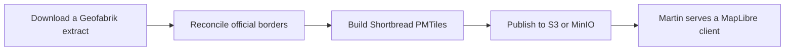
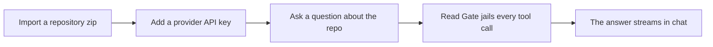
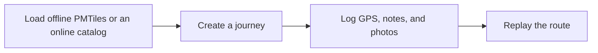
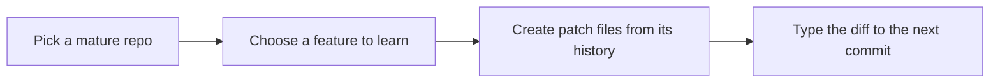
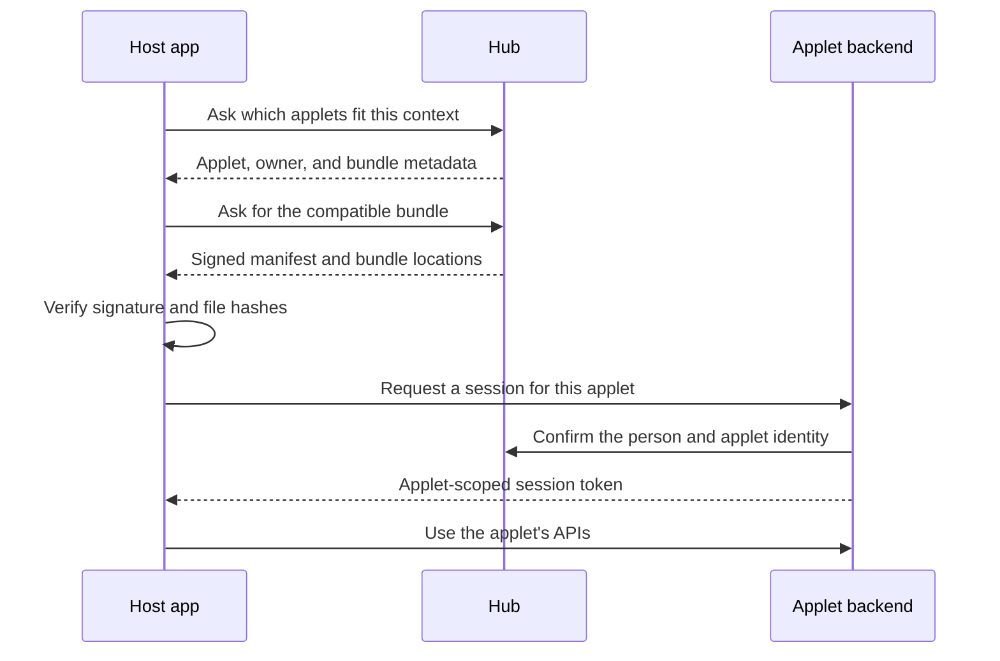
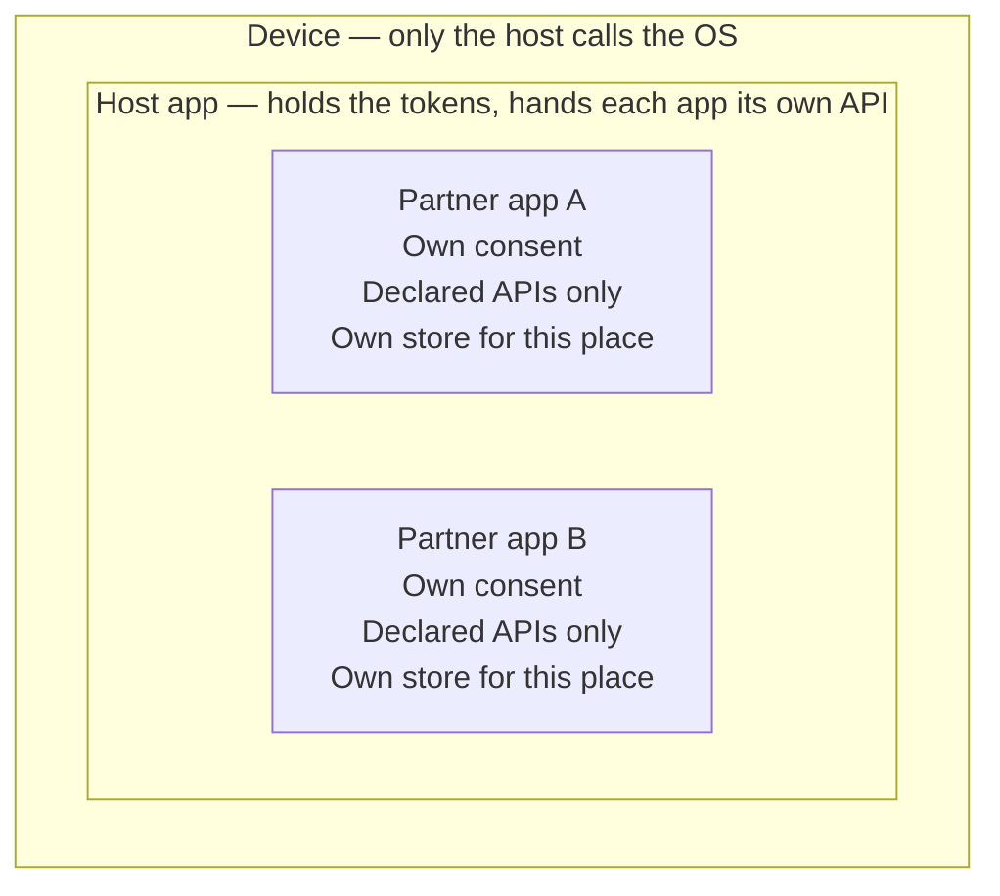
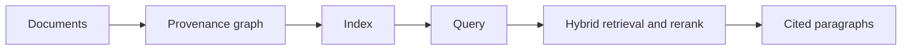
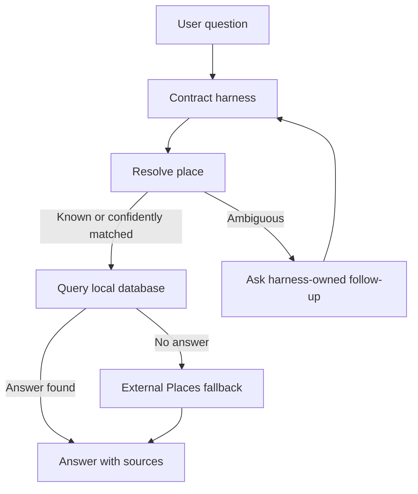

# Uttaran Wary

I design systems that stay honest under pressure — maps you can host yourself, mobile apps that load untrusted code without handing it the keys, and backends that treat tenancy, search, and deploy cutovers as first-class design problems.

Most of my recent work sits at the intersection of **Python backends**, **React Native hosts**, and **infra you can reason about**: signed bundles, capability boundaries, hybrid retrieval, agent loops with contracts, blue/green cutovers. I ship my own tools under [ubworks](https://github.com/kirtimukh).

📧 [uttaran.wary@gmail.com](mailto:uttaran.wary@gmail.com) · [GitHub](https://github.com/kirtimukh) · [LinkedIn](https://www.linkedin.com/in/captainvyom-48187a193/)

---

## Featured projects

### [making-maps](https://github.com/kirtimukh/making-maps)

A **self-hosted map stack** — not a thin wrapper on someone else's tiles.

OpenStreetMap extracts go through a documented pipeline: official border reconciliation, neighbour-PBF surgery for contested geography, Shortbread-style **PMTiles**, then **Martin** on S3/MinIO with a FastAPI + SpatiaLite admin API in front. Nginx keeps tile and API origins separate; production can use instance-role access instead of static keys. The point is ownership: every layer (basemap, admin boundaries, publish path) is reproducible and yours.

Routing (Valhalla) exists as an experiment on the side — interesting, not the core claim.

### [talk-to-repo](https://github.com/kirtimukh/talk-to-repo)

A **mobile, ask-mode-only** AI assistant for open-source repos. Bring your own API keys. Read, list, find, grep, ask — no shell, no edits, no on-device indexing.

The interesting part is the **trust model**: a Read Gate that jails every tool call to a workspace alias, caps exfiltration, denylists secrets, and refuses to pretend prompts are a security boundary. The agent loop is a vendored, patched port of a desktop stack onto Hermes — with CI that fails if Node APIs, write tools, or plaintext credential stores sneak back in.

### [travelog](https://github.com/kirtimukh/travelog)

An Expo travel journal: **background GPS**, notes and photos, journey state (scheduled → ongoing ⇄ paused → done), and map replay.

Two basemap stories — offline (upload and validate a `.pmtiles` before the map unlocks) and online (viewport-driven multi-region catalog fed by the making-maps pipeline). Built so the field recorder and the map stack can evolve independently.

### [CodeApe](https://github.com/kirtimukh/CodeApe)

Learn a codebase by **typing through its commits**. First-parent history becomes a lesson sequence; you type additions, accept deletions, resume per hunk. The original repo stays untouched — CodeApe clones into an isolated workspace and never mutates your checkout.

Smaller surface area than the others, but the isolation story is clean and the learning loop is real.

---

## Recent work

Systems work. The themes below are what I actually design and ship — architecture first, screens second.

### One host app, separate ownership

A single React Native host app, one hub, and more than one backend. It is a superapp with a signed front door — not a single-platform account with a grid of tiles. Each backend remains a complete product: its own data, roles, permissions, access control, and business logic.

The architecture is powered by:

1. **Re.Pack’s Module Federation**, implemented for scoped capabilities. The host discovers, verifies, and dynamically loads applet bundles; signed manifests, file hashes, version ranges, and an explicit capability membrane keep each remote least-privilege.
2. **PKI-based data integrity and identity management.** The hub signs the person and the applet, while the host negotiates a session token with the applet’s backend. That server verifies the signature before applying its own roles to its own data.

This keeps ownership separate even when applets share one install: two applets can be two businesses, with the host orchestrating them without becoming their backend.

The session and bundle flow:

The on-device boundaries:

### Knowledge, retrieval & agent contracts

Locality-scoped **knowledge graphs** with provenance. Hybrid claim retrieval — full-text, classical ranking, dense vectors, cross-encoder rerank, fusion — behind **versioned index generations** you can build, validate, and activate atomically, with incremental re-embed when the corpus barely moved.

Separately: **contract-driven agentic Q&A** over place knowledge. Multi-round tool loops with hard intake limits, harness-owned follow-ups, geo resolution that refuses to guess (alias → area → trigram → geocode with learn-on-miss), and DB-first answers before any external Places fallback. Knowledge writes stay on a deliberate ingest path; the runtime stays read-mostly.

### What I care about in these systems

- Clear boundaries between each app, service, and owner
- Verify signatures and permissions before loading or sharing anything
- Build and release pipelines that are repeatable and safe
- Search and agents that use sources, follow rules, and admit uncertainty

---

## Older projects

Smaller, earlier experiments — still live, still useful as a sense of range.

| Project                                   | What it is                                                                      |
| ----------------------------------------- | ------------------------------------------------------------------------------- |
| **[Cells](https://cells.ubworks.co)**     | Browser jigsaw builder with real-world style controls, geometry and interaction |
| **[Echo](https://echo.ubworks.co)**       | Sticky HTTP affinity demo — Nginx + WebSockets                                  |
| **[Knights](https://knights.ubworks.co)** | Move the knight across the board — constrained search as a playable surface     |

---

## Stack

Things I reach for when the problem is real.

| Area              | Tools & ideas                                                                                                    |
| ----------------- | ---------------------------------------------------------------------------------------------------------------- |
| Languages         | Python · JavaScript                                              |
| Backends          | Django · FastAPI · Postgres · Redis                              |
| AI / retrieval    | OpenAI-style tool calling · hybrid search (FTS + dense + rerank) |
| Infra             | Docker · Nginx · S3 / MinIO · Sentry                             |
| Writing code      | Cursor · OpenCode                                                |
| Misc              | Linux · Bash · SSH · Cloud Compute · Containers & Functions      |

If you want to talk system integrations, federated mobile architecture, knowledge graphs & retrieval — email is the shortest path.
